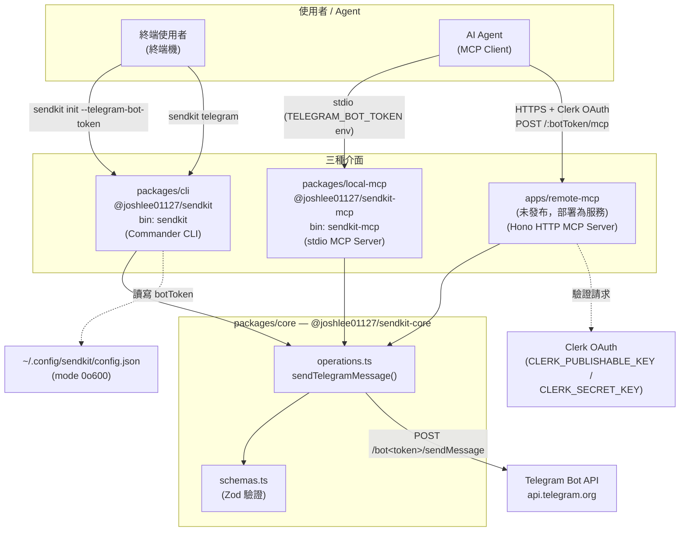
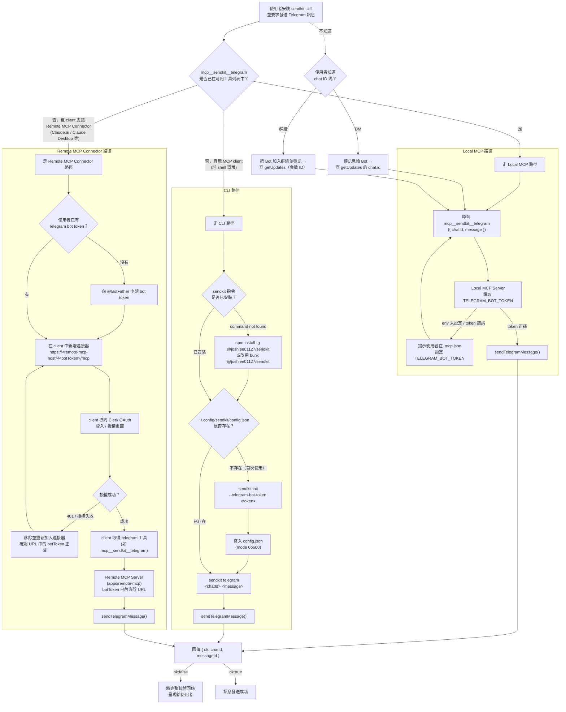
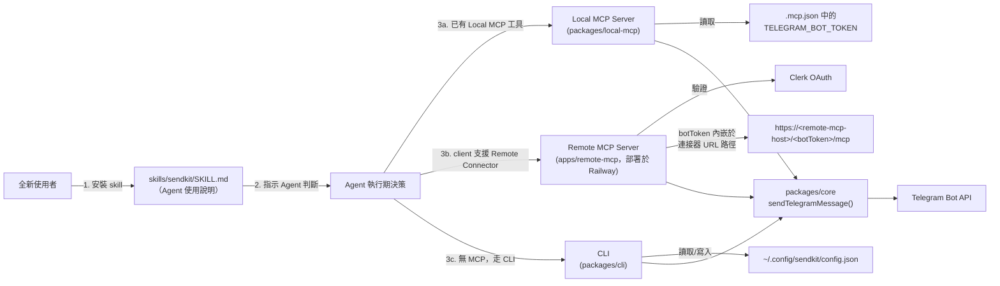

# SendKit 架構圖

SendKit 是一個 Bun workspace monorepo，透過三種介面（CLI / 本地 MCP / 遠端 MCP）發送 Telegram 訊息，三者都共用同一份核心實作 `packages/core`。

## 整體架構

## 套件說明

| 套件 | 名稱 | 定位 |
|---|---|---|
| `packages/core` | `@joshlee01127/sendkit-core` | 唯一與 Telegram API 溝通的地方。匯出 `sendTelegramMessage()` 與 Zod schema（`schemas.ts`）。其他套件都依賴它，不重複 HTTP 邏輯。 |
| `packages/cli` | `@joshlee01127/sendkit`（bin: `sendkit`） | 基於 Commander 的 CLI。`sendkit init --telegram-bot-token <token>` 將 token 寫入 `~/.config/sendkit/config.json`（權限 `0o600`）；`sendkit telegram <chatId> <message>` 發送訊息。 |
| `packages/local-mcp` | `@joshlee01127/sendkit-mcp`（bin: `sendkit-mcp`） | stdio MCP Server，提供 `telegram` 工具。從環境變數讀取 `TELEGRAM_BOT_TOKEN`（由 MCP client 設定，例如 `.mcp.json`）。 |
| `apps/remote-mcp` | （未發布，作為服務部署） | 基於 Hono 的 HTTP MCP Server。bot token 放在 URL 路徑中（`/:botToken/mcp`），並透過 Clerk OAuth 驗證請求（需要 `CLERK_PUBLISHABLE_KEY` / `CLERK_SECRET_KEY`）。 |

## 資料流程（以 `telegram` 操作為例）

1. 使用者/Agent 透過三種介面之一觸發發送請求（CLI 參數、stdio MCP 工具呼叫、或 HTTP MCP 請求）。
2. 各介面各自負責取得 `botToken`：
   - CLI 從本機設定檔 `~/.config/sendkit/config.json` 讀取。
   - Local MCP 從環境變數 `TELEGRAM_BOT_TOKEN` 讀取。
   - Remote MCP 從 URL 路徑參數讀取，並先以 Clerk 驗證請求身分。
3. 三者都呼叫 `packages/core` 的 `sendTelegramMessage()`。
4. `sendTelegramMessage()` 用 Zod schema 驗證輸入/輸出，並呼叫 `https://api.telegram.org/bot<token>/sendMessage`。
5. 回傳結果（`ok` / `chatId` / `messageId`）沿原路徑回傳給呼叫端。

## 新增「發送 X」功能的擴充模式

依 `CLAUDE.md` 的規範，新增操作時：

1. 先在 `packages/core` 新增操作與對應的 Zod schema。
2. 再依照 `telegram` 的實作模式，分別串接到 CLI、Local MCP、Remote MCP 三個介面。
3. 若工具介面或設定步驟有變動，同步更新 `skills/sendkit/SKILL.md`。

## 全新使用者安裝 Skill 後的流程

`skills/sendkit/SKILL.md` 是給 Agent 讀取的使用說明，教 Agent 在「本地 MCP 工具」「Remote MCP Connector」與「CLI」三者之間做選擇。以下是一個全新使用者安裝此 Skill 後，Agent 實際判斷與執行的流程。

> Remote MCP（`apps/remote-mcp`）預計部署於 [Railway](https://railway.com/)，最終網域待發布後回填至下方的 `<remote-mcp-host>`。

### 決策流程圖

### 對應的元件關係

### 流程摘要

1. **安裝 Skill**：使用者（或其 Agent 環境）安裝 `sendkit` skill，Agent 讀取 `SKILL.md` 取得使用規則。
2. **選擇介面**：Agent 依「決策表」三選一——
   - 已有 `mcp__sendkit__telegram` 工具 → 用 **Local MCP**。
   - 沒有本地工具，但 client 支援 Remote MCP Connector（例如 Claude.ai、Claude Desktop）且使用者不想做本地設定 → 用 **Remote MCP Connector**。
   - 純 shell 環境、無任何 MCP client，或使用者想手動驗證 → 用 **CLI**。
3. **首次設定（依介面不同）**：
   - **Local MCP**：需在 `.mcp.json` 設定 `TELEGRAM_BOT_TOKEN` 環境變數，MCP Server 啟動時讀取。
   - **Remote MCP Connector**：不需安裝、不需環境變數。使用者在支援的 client 中新增連接器 `https://<remote-mcp-host>/<botToken>/mcp`（`<remote-mcp-host>` 為部署在 Railway 的網域，待發布），client 會導向 Clerk OAuth 完成一次性授權，之後即可使用 `telegram` 工具。
   - **CLI**：若尚未安裝，先安裝 `@joshlee01127/sendkit`（`npm install -g @joshlee01127/sendkit` 或 `bunx @joshlee01127/sendkit`）；首次使用需執行 `sendkit init --telegram-bot-token <token>` 寫入本機設定檔。
4. **取得 chat ID**（若使用者不知道）：透過 `https://api.telegram.org/bot<TOKEN>/getUpdates` 查詢 DM（正數 ID）或群組（負數 ID）的 chat ID。
5. **發送訊息**：無論走哪條路徑，最終都呼叫 `packages/core` 的 `sendTelegramMessage()`，統一由核心邏輯呼叫 Telegram API 並回傳 `{ ok, chatId, messageId }`。
6. **錯誤處理**：常見錯誤（token 缺失、chat not found、bot 被封鎖、指令未安裝、Remote Connector 401）依 `SKILL.md` 的疑難排解表對應處理。
